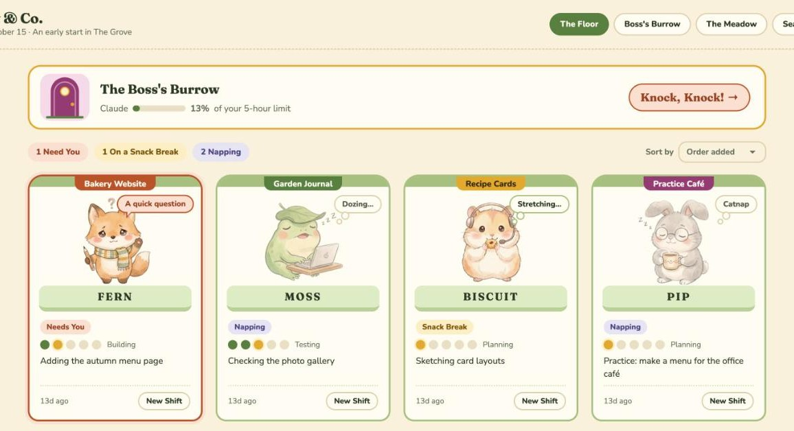

# Burrow & Co.

*(Formerly Agent Office.)* A visual office for your Claude Code workers. One cubicle per project, one critter per cubicle, one chat per "day".



> **Early days.** Burrow & Co. is one person's project, made and used every day on a Mac. Windows and Linux pass automatic checks on real Windows and Linux computers, but no person has tried them yet. If something goes wrong, please [open an issue](https://github.com/megan-sweeting/burrow-and-co/issues/new).

## What you need

- **A Mac, a Windows PC or a Linux computer.** The office was made on Apple silicon Macs running macOS 13 or newer. Windows and Linux run the browser-only version: the same office in your browser, without the Mac app. See [Windows and Linux](#windows-and-linux) for what's different.
- **Node.js 18 or newer.** Check with `node --version`. If you don't have it, install it from https://nodejs.org (the LTS download) or with Homebrew: `brew install node`.
- **Claude Code, installed and logged in.** The office runs the `claude` command on your computer, so it must be on your `PATH`.
  - Install it: https://code.claude.com/docs/en/setup
  - Log in once in a terminal (Terminal on a Mac): run `claude`, follow the login steps, then quit it.
  - **You need a paid plan** (Claude Pro or Max, or an Anthropic Console account with API billing). The office uses your normal Claude Code login and settings, so every critter's work counts against your plan's usage, the same as using Claude Code yourself.
  - **Prefer an API key?** Anthropic's Agent SDK terms expect apps built on it to use API keys, so this is the fully supported option. Create a key at https://console.anthropic.com, then start the office with it: `ANTHROPIC_API_KEY=your-key npm start` (in Windows PowerShell: `$env:ANTHROPIC_API_KEY="your-key"; npm start`). Critters then bill to your Console account instead of your plan.
- **Optional:** `git` for the Changes tab and Save & Publish, the GitHub CLI (`gh`) for pull requests, and [Tailscale](https://tailscale.com) for the phone chat page.

## Install

1. Download or clone this folder anywhere you like, for example into `~/Claude/Projects`:

   ```bash
   cd ~/Claude/Projects
   git clone https://github.com/megan-sweeting/burrow-and-co.git
   ```

2. In a terminal, go into the folder and install its packages:

   ```bash
   cd burrow-and-co
   npm install
   ```

3. Start the office:

   ```bash
   npm start
   ```

4. Open http://localhost:4545 in your browser. Leave the Terminal window open while you use the office.
5. The first time, a welcome screen asks for your name and where your projects live (default `~/Claude/Projects`). Each folder in there can become a cubicle.

If the Terminal says it **could not find the claude command**, Claude Code isn't on your `PATH`. Install it (see above), open a new Terminal window, and start the office again. You can also point the office at it directly: `CLAUDE_BIN=/path/to/claude npm start`.

### Settings you can change when starting it

| Setting | What it does | Default |
|---|---|---|
| `OFFICE_PORT` | The port the office runs on | `4545` |
| `OFFICE_DATA` | Where the office saves everything it knows | `office.json` in this folder |
| `CLAUDE_BIN` | Where the `claude` command is | found on your `PATH` |
| `OFFICE_TAILSCALE_LOGIN` | The one Tailscale login allowed to use the phone chat page | your own Tailscale login, if Tailscale is installed |

For example: `OFFICE_PORT=4600 npm start` (in Windows PowerShell: `$env:OFFICE_PORT=4600; npm start`).

### Optional: the Mac app

`app/` holds a small Mac app that wraps the office in its own window and shows approval notifications. Build it with:

```bash
cd app
./build.sh
```

It installs to `~/Applications/Burrow & Co.app` and remembers which folder the office lives in. If that app was built from a different copy of the office, it asks before switching (`FORCE=1 ./build.sh` skips the question). To use your own bundle ID, run `BUNDLE_ID=com.yourname.agent-office ./build.sh`. It needs Xcode or the Xcode Command Line Tools (`xcode-select --install`), and it always opens http://localhost:4545, so keep the default port if you use it.

Its menu bar has **Check for Updates…**, **Settings…** (⌘,) and **Restart the Office…** under Burrow & Co.; page shortcuts (⌘1 The Floor, ⌘2 Boss's Burrow, ⌘3 The Meadow, ⌘K Search) and text size (⌘+, ⌘−, ⌘0) under View; and help, the office tour, problem reports and the Ko-fi page under Help.

## Windows and Linux

The office runs the same way on Windows 10/11 and Linux: `npm install`, `npm start`, then open http://localhost:4545 in your browser. There is no app wrapper, so use the browser's own notifications (Settings → Alerts) for "May I?" pop-ups.

**Before you start**

- **Windows:** install Claude Code with the native installer so `claude.exe` is on your `PATH` (the npm `claude.cmd` can't be started by the office; if that's all you have, point to an exe with `CLAUDE_BIN`). Install [Git for Windows](https://git-scm.com/download/win): Claude Code runs commands through Git Bash.
- **Linux:** install `bubblewrap` and `socat` (for example `sudo apt install bubblewrap socat`) so **Free inside the project folder** can use Claude Code's sandbox.

**What's different**

| | Mac | Windows | Linux |
|---|---|---|---|
| Free inside the project folder | Sandboxed: commands run without asking | No sandbox on Windows: file edits run without asking, every command asks | Sandboxed if `bubblewrap` and `socat` are installed; otherwise every command asks |
| Sign In to Claude | Opens Terminal | Opens a new console window | Opens your terminal app (or shows the command to type) |
| Open Folder, previews, pull requests | Finder and your browser | File Explorer and your browser | `xdg-open` |
| Open in Claude Desktop | Yes | Yes (untested) | Hidden: there is no Claude desktop app for Linux |
| Phone chat over Tailscale | Yes | Yes | Yes |

**Guardrails on each system.** Critters never delete core system files or the whole disk or home folder, and always ask before anything below:

- **Mac:** system folders (`/System`, `/Library`, `/usr`, `/Applications`…), the keychain, `sudo`, `launchctl`, `defaults write`, Homebrew installs.
- **Windows:** `C:\Windows`, `Program Files`, `ProgramData`, the Startup folder and PowerShell profiles; Credential Manager and browser data; administrator commands (`runas`, `sudo`, `-Verb RunAs`), the registry (`reg add`, `Set-ItemProperty HKLM:`…), services, scheduled tasks, Defender and firewall settings, `Set-ExecutionPolicy`, disks; `winget`/`choco`/`scoop` installs; `irm … | iex`.
- **Linux:** `/etc`, `/usr`, `/boot`, `/opt`, `/var/lib`, `/dev`…, autostart and systemd user folders; the keyring, `pass` and browser profiles; `sudo`/`pkexec`, `systemctl` changes, mounting and formatting disks, firewall, users and passwords, `gsettings`/`dconf`; `apt`/`dnf`/`pacman`/`snap`/`flatpak` installs.
- **Everywhere:** passwords and keys (`~/.ssh`, `~/.aws`, `~/.gnupg`…), Claude's own settings, the office itself, files outside the project, deleting folders, `git push`, publishing packages, global installs and `curl … | sh`.

Every change is checked automatically on real Windows, Linux and Mac computers (the guardrails, and that the office starts), but no person has used the Windows or Linux versions yet. If something doesn't work, please [open an issue](https://github.com/megan-sweeting/burrow-and-co/issues/new).

## How it works

- **Cubicle** = a project folder. Its critter is Claude Code running in that folder with your normal login and settings.
- **The Meadow** is the hiring pool: 16 critters (art in `assets/critters/`). Click *Hire a critter* to open a new cubicle.
- **Close Project** (in a cubicle's Details) files everything away and sends the critter back to the Meadow. Reopen it any time from *Closed projects* on the floor.
- **New day** files today's chat under Past days. Your next message starts a fresh chat.
- **Approvals** pop up bottom-right whenever a critter wants to edit files or run a command.
- **Open in Claude Desktop** moves the chat into the Claude desktop app for the browser pane, diffs, artifacts and simulator. Only type in one place at a time. (See the warning below.)
- **Critters update their own cubicle** (task, stage, status, notes) and can read and check off your to-dos from the Boss's Burrow.

Everything the office knows is saved in `office.json` next to this file. It holds your chats and settings, so keep it private; it is already in `.gitignore`.

## Things to know

> **⚠ The Claude desktop links are undocumented.** *Open in Claude Desktop* works by opening `claude://resume?session=…` (or `claude://code/continue?session=…`) links, and by reading the desktop app's session files. Anthropic hasn't documented or promised any of this. It works today, but an update to the Claude desktop app could break it without warning. If it stops working, everything else in the office still works; just keep chatting in the office.

- **Your usage.** Each critter is a real Claude Code session on your plan. Several busy critters use your plan's limits faster. Settings → Critters lets you pick the model and effort level.
- **It only listens on your Mac.** The office answers on `127.0.0.1` only. The phone chat page works through `tailscale serve`, and only for your own Tailscale login.
- **Approvals matter.** Critters can edit files and run commands in their project folders. Read the approval pop-ups before you click Allow.
- **When Claude's login runs out**, critters say "Not logged in". A banner in their chat has a **Sign In to Claude** button: it opens Terminal running `claude /login` (the first time, macOS asks whether the office may control Terminal). Finish there, press **I'm Signed In**, then **Try Again**. If the office still can't see the sign-in, **Restart the Office** in the Mac app usually fixes it. Typing `/login` in a chat starts the same steps.

## Support Burrow & Co.

Burrow & Co. is free. If it makes your days a little nicer and you'd like to say thanks, you can leave a tip here: https://ko-fi.com/megansweeting

## License

MIT. See [LICENSE](LICENSE).
